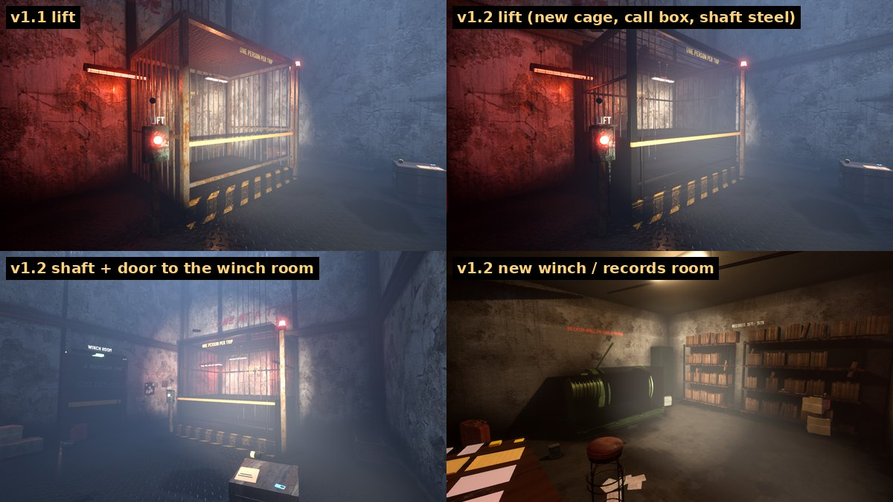
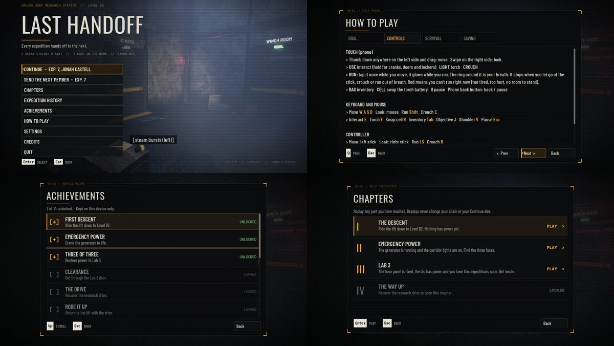
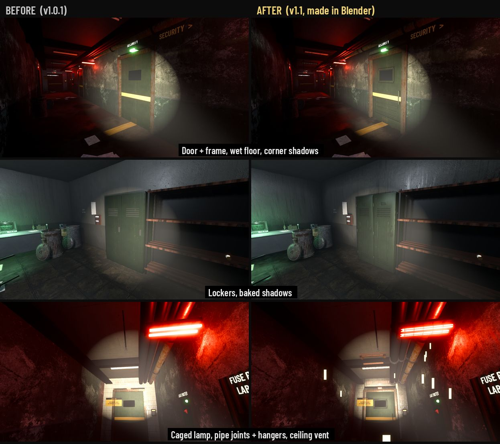
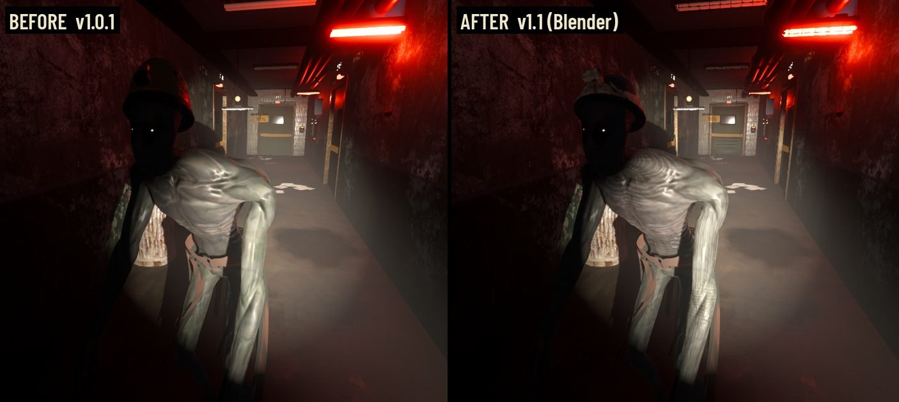

# LAST HANDOFF

**A third-person survival horror game where every expedition hands off to the next.**
Made in Godot 4 by **Sonujeet**. Single-player, fully offline, free.

### ▶ Play it free: [sonujeet.itch.io/last-handoff](https://sonujeet.itch.io/last-handoff) (Windows 64-bit and Android APK)

**Current version: v1.2.0.** No ads, no in-app purchases, no accounts, no online anything.



## The pitch

Halden Deep Research Station, Level B2. Something went wrong down here, and you are not the first one sent to find out.
The cage goes down one person per trip. You restore power, solve your way through a dead facility with a flashlight
that keeps running out, and try to bring Dr. Varga's research drive back up, while something in the dark listens for you.

You probably won't make it. That's fine. Someone comes after you.

## The handoff

Every run is one **expedition**, played by a new named member of the team. When your run ends (death, extraction, or giving up):

- you leave a **message** for the next expedition (templates or your own words),
- you leave **one item** in the handoff crate at the bottom of the shaft,
- you leave a **chalk mark** where your run ended.

The next member starts at that crate, finds your item and your note, sees the marks every earlier expedition left,
and inherits the world exactly as you left it: doors you opened stay open, generators you fixed keep running, puzzles stay solved.
**Decisions stick across expeditions** and decide which of the **3 endings** the chain reaches. The main menu keeps
a local **expedition history**: every member, how deep they got, how it ended, what they left and what they decided.

## Features

- Third-person explorer with an over-the-shoulder camera, flashlight + battery cells, stamina, injuries and limping
- **The Keeper:** a creature that hunts by sound on a navmesh (patrol, investigate, chase, lose track), backs off from
  your flashlight, crawls through the vents, and checks lockers it saw you get into. Hide in lockers or under cots
- Hazards: steam bursts, live wires once the power is back, gas that punishes a lit flashlight
- Puzzles: a generator, breakers, a fuse panel, keycards and a keypad code that changes every expedition
- Environmental storytelling: voiced audio logs, research documents, scrawls and camps from earlier expeditions
- Atmosphere: PBR materials, volumetric fog, power-tied and emergency lighting, room-tone ambience and a tension layer
- Cold-open lift descent, "Expedition N" title cards, in-engine ending sequences with end cards
- Save/continue with atomic writes, a backup slot and corrupt-save recovery
- Full settings: audio, graphics presets (Low / Medium / High / Phone), keyboard **and gamepad** rebinding,
  hold/toggle sprint and crouch, subtitles and sound captions, colour-blind-safe prompts, camera shake, brightness calibration
- Android build with touch controls (floating stick, swipe look, safe-area aware layout)
- **1,462 headless automated checks** across every system (`tests/`), plus a balance simulator that plays
  scripted runs against the real Keeper to keep it fair

## What's new

**v1.2**
- Heartbeat + phone vibration that speed up as the Keeper gets close (controller rumble on PC), with Settings toggles
- Fake-out scares: rattling lockers, lamp brownouts, distant thuds and footsteps, vent creaks (never during a real chase)
- Remodelled lift and shaft, made in Blender, plus a new room to explore: the lift winch / records room
- Chapter select and 14 offline achievements (a few are secret), with unlock toasts
- A How to Play screen on the main menu (touch, keyboard + mouse and controller)
- RUN fixed on phones: tap-to-run by default, a bigger button, a stamina ring and "out of breath" hints

**v1.1**
- 13 keyframed Keeper animations made in Blender
- Graphics pass made in Blender: a sculpted Keeper with a cracked helmet, new doors, lockers, caged lamps, pipes and vent,
  baked room shadows, wet floors and rust streaks

**v1.0.1**: 19 bug fixes (Android back button, pause on app switch, safe-area touch layout and more).

## Screenshots

| | |
|---|---|
|  |  |
|  |  |
|  |  |

## Controls

All rebindable in **Settings › Controls** (keyboard and gamepad). On phones, on-screen buttons appear automatically.

| Action | Keyboard / mouse | Gamepad |
|---|---|---|
| Move | WASD / arrows | Left stick |
| Look | Mouse | Right stick |
| Run (hold or toggle) | Shift | L3 / LB |
| Crouch (toggle or hold) | C / Ctrl | B |
| Interact (tap or hold) | E | A |
| Flashlight | F | Y |
| Swap battery cell | R | X |
| Inventory (U use, G drop) | Tab / I | Back |
| Show objective | J | D-pad up |
| Switch shoulder | V | R3 |
| Skip intro / cinematic | Space / Esc | A / Start |
| Pause | Esc | Start |
| Debug overlay (off by default) | F3 | – |

## Open it in Godot

1. Install **Godot 4.7** (developed on 4.7.2 stable, standard build, GDScript only, no C#).
2. Clone this repo, then in the Project Manager choose **Import** and pick `project.godot`.
3. The first import takes a minute (the `.godot/` cache is not in the repo). Press **F5** to play; the main scene is `scenes/ui/main_menu.tscn`.

Renderer: **Forward+** (Vulkan / D3D12). Phones use the Mobile renderer; it also runs with
`--rendering-method gl_compatibility` (fog and SSAO swap for simpler depth fog).

Run the test suite headless:

```bash
godot --headless --path . --import
godot --headless --path . res://tests/run_tests.tscn
```

Export presets for **Windows Desktop**, **Linux** and **Android** are in `export_presets.cfg` (no signing keys are
included; Android signing comes from Godot's `GODOT_ANDROID_KEYSTORE_RELEASE_*` environment variables).
Developer notes (folder layout, generators, Blender scripts, screenshot harness, balance simulator, perf probe,
release builds) are in [docs/DEVELOPMENT.md](docs/DEVELOPMENT.md), [BALANCE.md](BALANCE.md) and [PERFORMANCE.md](PERFORMANCE.md).

## Credits

Design, code and direction: **Sonujeet**.
Third-party assets (Quaternius characters and animations, Poly Haven textures and props, Google Fonts) are CC0 or OFL;
the Blender models, animations and bakes, sound effects, voices and music were made for the project.
Everything is listed with its licence in [CREDITS.md](CREDITS.md).

## License

**Source-available, all rights reserved.** You're welcome to read the code; you may not copy, modify, redistribute
or republish it or the game. See [LICENSE](LICENSE). Third-party assets keep their own licences (see CREDITS.md).

## Repository notes

To fit GitHub's upload limits, a few large source files in this repo are smaller copies of the ones the game was built with:

- `assets/characters/explorer/T_Explorer_Normal.png` and `T_Hair_1_Normal_png.png`: re-encoded (differences of at most 1/255 per channel; the hair normal map's unused alpha channel dropped)
- `audio/music/drone.wav`: resampled from 44.1 kHz to 22.05 kHz (same length)
- `assets/props_v11/level_ao.png`: stored as 8-bit greyscale instead of RGB (pixel-identical; the map was already grey)

The released builds on itch.io use the originals. Build outputs (exe, APK), the editor cache and signing keys are not in the repo.
